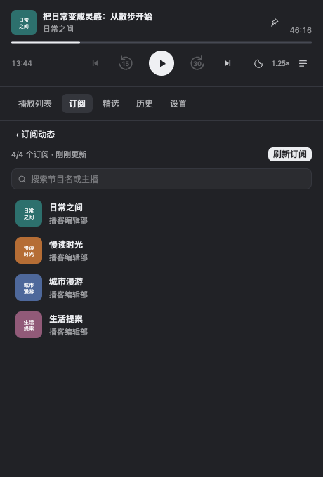
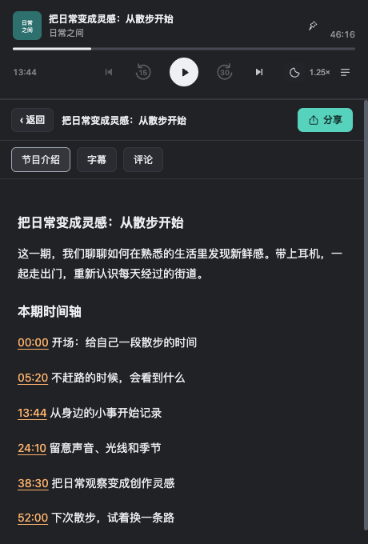
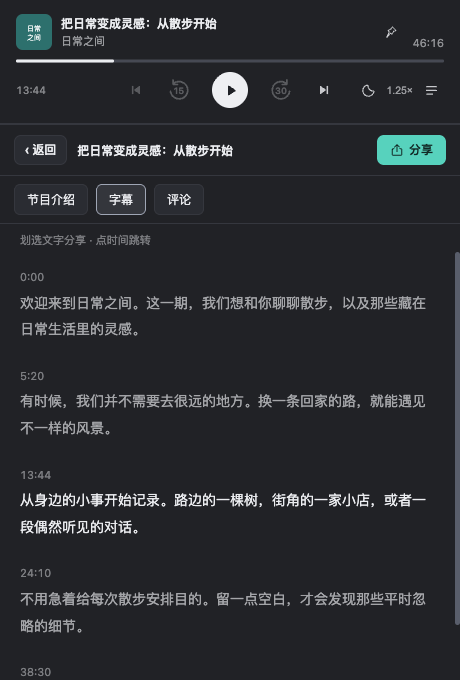
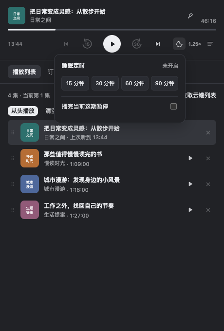
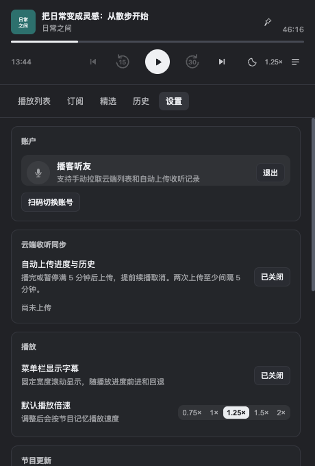
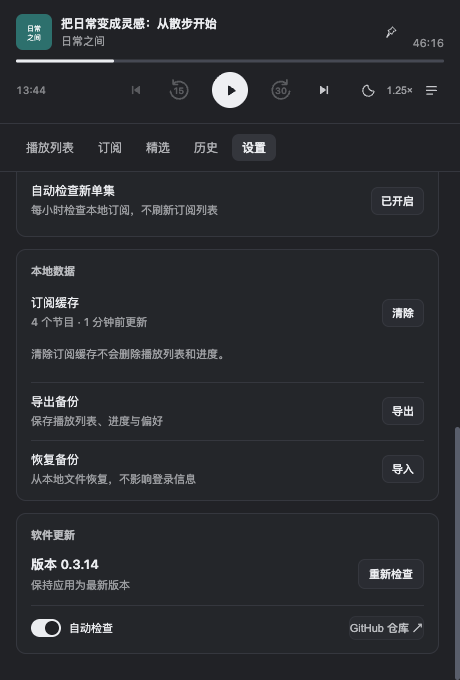

# 小宇宙播放器

个人开发的第三方小宇宙播放器，非官方客户端。

在 macOS 菜单栏听小宇宙。收起窗口后继续播放，不占 Dock，播放列表和收听进度保存在本机。

支持 Apple Silicon Mac（M1 及后续机型）和 Windows 10/11 x64。Windows 版在系统托盘运行，并提供桌面悬浮字幕。

[下载最新版](https://github.com/sgaxun/xiaoyuzhou-player/releases/latest) · [更新记录](CHANGELOG.md)

## 界面预览

以下截图使用当前 0.3.14 界面代码，在 macOS 浏览器中以演示数据渲染；节目、文稿及账号为示例，不代表真实内容。截图展示应用内界面，Windows 原生托盘和桌面字幕仅作文字说明。

<table>
  <tr><th>播放列表与云端拉取</th><th>本地订阅与搜索</th></tr>
  <tr>
    <td></td>
    <td></td>
  </tr>
</table>

  
更多界面：节目介绍、字幕、睡眠定时、分享卡片与设置

<table>
  <tr><th>节目介绍与时间戳</th><th>官方字幕阅读界面</th></tr>
  <tr>
    <td></td>
    <td></td>
  </tr>
</table>

<table>
  <tr><th>睡眠定时</th><th>二维码分享卡片</th></tr>
  <tr>
    <td></td>
    <td></td>
  </tr>
</table>

<table>
  <tr><th>账户、云端同步与播放设置</th><th>本地备份与软件更新</th></tr>
  <tr>
    <td></td>
    <td></td>
  </tr>
</table>

## 开始使用

1. macOS：下载 DMG，将「小宇宙播放器」拖入「应用程序」并启动。Windows：在 Release 提供 Windows 附件后，下载 `xiaoyuzhou-player-setup-<版本>-amd64.exe` 安装；需要 WebView2 Evergreen Runtime。
2. 点击 macOS 菜单栏或 Windows 系统托盘图标，在「设置 → 账户」中使用小宇宙 App 扫码登录。
3. 进入「订阅 → 全部订阅」，点击「拉取订阅」，同步关注的节目。
4. 选择单集直接播放，或通过加号加入播放列表。

macOS 安装后即可使用；Windows 需要 WebView2 Evergreen Runtime。macOS 安装包尚未经过 Apple 公证；首次打开若被系统拦截，可在「系统设置 → 隐私与安全性」中允许打开。

## 主要功能

- **菜单栏／托盘播放**：播放／暂停、上一集／下一集、快退 15 秒、快进 30 秒，支持系统媒体控制。
- **播放列表**：选择下一集播放或加入队尾，支持批量加入、拖动排序，播完自动接下一集。
- **云端收听同步**：手动拉取云端播放列表及进度，可选自动上传进度与收听历史，默认关闭自动上传。
- **本地续播**：保存播放进度，重启后可继续收听；首次播放前也能调整时间轴。
- **进度预览**：显示当前进度与剩余时间，鼠标移到时间轴上即时预览对应时间。
- **节目倍速**：支持 0.75×–2× 倍速和音量调节，按节目记忆播放速度。
- **睡眠定时**：支持 15、30、60、90 分钟快捷定时，或播完当前这期后暂停。
- **订阅动态**：汇总本地订阅的新单集，支持定时检查、手动检查和忽略。
- **内容浏览**：搜索节目与单集，浏览精选榜单、本地播放历史、节目介绍和封面大图。
- **字幕与摘录**：查看随播放高亮的官方字幕，点击时间点跳转，划选文字生成摘录分享卡。
- **单集评论**：支持全部、最新和时点排序，分页查看评论与回复，进入后才加载。
- **菜单栏／桌面字幕**：macOS 在菜单栏显示固定宽度滚动字幕，Windows 在桌面底部显示置顶字幕条；暂停和拖动进度时同步，默认关闭，开关会保存在本机。
- **窗口置顶**：图钉一键置顶，切换应用时保持窗口展开，默认关闭。
- **分享节目**：复制整期或指定时间点的链接，生成可保存、复制的二维码分享卡。
- **界面与数据**：跟随浅色／深色外观，支持本地备份恢复和应用内更新。

## 播放与节目介绍

点击单集右侧的 **＋**，选择「下一集播放」或「加入队尾」，不会打断当前播放。已入队的单集显示勾选状态，可在播放列表中移除或拖动排序。

点击标题或单集行打开节目介绍（shownotes）。介绍中的时间戳可点击跳转，返回后保留原页面；被省略的单集标题可悬停查看全文。尚未入队的单集，也可通过返回按钮旁的队列图标加入下一集或队尾。

播放器控制区的月亮图标用于设置睡眠定时。可选择快捷时长，或开启「播完当前这期暂停」；退出应用后定时不保留。

音频加载或缓冲时保留节目名，播放失败后显示错误并可点击重试。

在单集页面切换到「字幕」，可跟随播放查看官方自动生成文稿；点击时间戳跳转，拖选文字可分享摘录。部分单集可能没有字幕，加载字幕需要登录。

「评论」位于「字幕」右侧，需要登录后读取。只有点击进入评论页才会请求；在节目介绍或字幕页不会预先加载评论。

- **全部**：按热门排序。
- **最新**：按发布时间从新到旧排列。
- **时点**：按评论中的节目时间点排列。

首次切换到某种排序时加载对应列表，点击「加载更多」继续翻页；点击「查看回复」才加载楼内回复。在同一次单集详情浏览中，切换字幕或排序、收起回复都会保留已加载的内容和列表位置，返回后无需重复请求。评论正文中的时间点可点击跳转播放。

菜单栏／桌面字幕默认关闭，开关会保存在本机，重启后沿用：macOS 在「设置 → 播放 → 菜单栏显示字幕」开启，或右键点击菜单栏图标切换同名开关；Windows 在「设置 → 播放 → 桌面底部显示字幕」开启，或右键点击托盘图标选择「桌面显示字幕」。开启后，开始播放时会加载当前单集字幕，无需进入字幕页；关闭时不会为菜单栏或桌面字幕主动加载文稿。

字幕条保持固定宽度，长段文字向左滚动，暂停时冻结、快进回退时跟随。滚动位置按字幕段落时长估算，并非逐字对齐语音；没有可用字幕时，macOS 只显示菜单栏图标，Windows 隐藏桌面字幕条。Windows 字幕条置顶且不抢占焦点，鼠标操作可穿透到下方窗口。

点击播放器顶部的图钉，或右键点击菜单栏／托盘图标选择「置顶窗口」，窗口会保持在其他窗口上方，切换应用不自动收起。再次点击取消置顶后恢复自动收起；每次启动默认不置顶，仍可点击菜单栏／托盘图标或按 Esc 手动收起。

## 订阅与新单集

「订阅」页展示待处理的新单集，完整节目列表收在右上角的「全部订阅」中。

- **同步订阅**：只有手动点击「拉取订阅／刷新订阅」才会同步账号的订阅列表。手机端新增或取消订阅后，需要在这里手动同步。
- **检查新单集**：只使用本地已保存的节目，访问公开节目页，不携带登录凭证。默认每小时检查一次，也可手动检查；自动检查可在「设置 → 节目更新」关闭。
- **加入播放列表**：单集加号可选择加入位置；「全部加入」将待处理单集追加到队尾并去重。已在播放列表中的单集不再显示。
- **忽略单集**：之后检查不会重复显示这期，同一节目未来的新单集仍会正常出现。
- **共创单集**：优先显示你订阅的节目名称和封面，并标注「共创」，加入播放列表后保留订阅来源。

自动检查仅在应用运行期间生效，收起窗口不影响检查。请求依次进行，并设置检查间隔；手动检查分批处理，有剩余节目时可继续检查。

首次检查只纳入最近 7 天范围内的新内容。公开节目页展示的单集数量有限，长时间未使用后可能无法补齐全部历史更新。

点击单集标题查看介绍、字幕或评论，点击节目名称进入应用内节目主页，点击封面放大预览；顶部播放栏、播放列表及单集列表使用相同的操作。

## 分享节目

打开节目介绍，点击右上角的「分享」：

- **复制链接**：复制小宇宙单集链接，可自行粘贴到聊天或其他应用。
- **分享卡片**：生成包含封面、标题、节目名和二维码的图片，支持「保存卡片」和「复制卡片」。

分享当前正在听的单集时，可选择「整期节目」或「当前时间点」，暂停时也可分享。时间点以打开分享面板时的位置为准，复制的链接和卡片二维码都会携带该位置；实际定位效果取决于打开链接的客户端。

分享卡片在本机生成，封面无法加载时使用节目名称占位。

在单集的「字幕」页，拖选想分享的文字，可跨段选择，生成摘录卡片。卡片保留所选文字和自然换行，显示摘录的起始时间，二维码指向该时间点。预览默认跟随系统浅色／深色外观，也可手动切换，支持保存图片或复制图片。

## 备份与更新

**本地备份**：在「设置 → 本地数据」导出或导入播放列表、进度和偏好。备份不包含登录凭证；导入会暂停播放并覆盖这些本地数据，保留登录信息和订阅缓存。换电脑前可先导出备份。

**软件更新**：在「设置 → 软件更新」检查新版本、查看更新说明或关闭自动检查。默认每 6 小时检查一次，只提示，不自动下载安装。发现新版后仍可「重新检查」，下载完成后点击「重启安装」；程序会先保存进度和播放列表。支持直接升级到最新正式版，无需逐版安装。

## 数据与隐私

播放列表、进度、历史、偏好及订阅缓存保存在本机：

- macOS：`~/Library/Application Support/XiaoyuzhouMenuBar`
- Windows：`%APPDATA%\XiaoyuzhouMenuBar`

登录与同步规则：

- 每位用户使用自己的账号扫码登录，登录凭证保存在本机。
- 播放列表可手动从云端拉取并合并到本地，已加入的单集会从订阅动态中移除。同时查询一页最近收听历史，本地列表中任何明确标记已听完的单集都会移除，不区分添加来源，也不要求已从云端列表消失。保留正在播放的单集；查询失败、记录不在最近一页或没有明确完成标记时保留，不后台轮询。
- 同时按需分批读取列表内单集的云端进度，用较新的收听记录衔接续播；保留本地更新的进度、待上传记录和当前已加载音频的位置。进度查询失败不影响导入列表，界面会提示。导入进度不产生上传任务，也不补齐全部手机历史。拉取期间如修改列表或切换节目，本次结果不合并，可重新拉取。不会向云端修改播放列表或订阅。
- 「设置 → 云端收听同步」可开启自动上传（默认关闭）：播完上传一次，暂停满 5 分钟上传一次，提前续播会取消。每次分别提交进度与收听历史，同一账号两次上传任务至少间隔 5 分钟（因此播完后可能等待）；失败会暂停该账号自动上传，手动重试后恢复，不定期轮询云端。
- 本地继续保存播放进度与历史，不会自动轮询或完整导入手机收听历史，也不批量上传以前的历史。
- 退出账号会删除登录凭证，并清理订阅缓存和订阅动态；本地播放列表与历史保留。
- 不内置遥测或统计上报。节目介绍中的图片及外部链接可能连接发布者或第三方网站。

## 开发与发布

应用使用 Go、React 和 MyGo 构建，macOS 音频播放使用系统 WebKit，Windows 使用 WebView2。

- [开发与本地构建](docs/DEVELOPMENT.md)
- [版本发布与更新签名](docs/RELEASING.md)
- [第三方代码与许可证](THIRD_PARTY_NOTICES.md)

界面及基础内容读取逻辑由 DSH 小宇宙插件适配，独立菜单栏宿主和 Go 后台在本项目中实现。项目尚未指定整体开源许可证，第三方代码遵循各自许可证。
